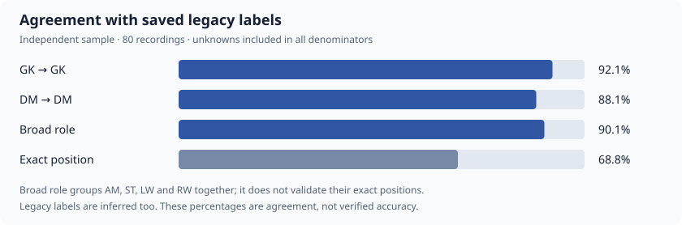

# Position inference — ЧР #16

Snapshot: 2026-11-08. Engine `positionVersion: 1`.

Position inference is now part of the active original-engine adapter. It adds
estimated roles without modifying the pinned legacy runtime, engine v2, existing
metrics, or saved Django statistics. No database writes or bulk reanalysis were
performed for this experiment.

## Method

- Use only captured live play, including substitutions. Sample movement at 10 Hz;
  count each player's presence at full tick resolution.
- Project coordinates along the line from the replay side's own goal to its
  opponent's goal. Side changes, rotated pitches and different scales use the same
  classifier. Home/away mappings do not enter the detector.
- Classify 30-second live-play windows using depth, separation from teammates,
  and how consistently a player stays behind their contemporaneous teammates.
- Detect GK independently of a fixed goalmouth distance: a keeper may advance
  with the team. Group outfield players into deeper DM, intermediate AM and front
  ST roles. Similar-depth forwards, including opposite flanks, can both be ST.
- Do not require four players or force one player into each role. Synthetic 3v3
  and 5v5 cases exercise this; the historical comparison is predominantly 4v4.
- Keep role distributions and period estimates. A player needs ten seconds in a
  window to receive its role; their main role needs 55% of observed play. Ambiguous
  appearances remain null. Confidence measures evidence consistency, not accuracy.

Thirty seconds is the inference resolution, not an exact timestamp for a tactical
change. The detector infers movement roles, not the captain's intended lineup.
Unsupported goal layouts are left unclassified.

## Historical comparison

The development database contains 410 legacy recordings for ЧР #16 (season PK 28).
Twenty recordings were used for calibration. After the rules were fixed, a
separate deterministic sample of **80 recordings, 76 matches and 157 matched replay
games** was evaluated. Sampling alternated BFF and futsal recordings so BFF was
not overwhelmed by the larger futsal catalogue. This is a stratified experiment,
not a season-wide population accuracy estimate.

The comparison contains **1,161 player/game/side entries**, not 1,161 unique people.
Only the six positions accepted by the old `tasks.py` importer were references:
GK, DM, AM, ST, LW and RW. Spectators and zero-playtime entries were omitted.

Games were matched uniquely by their scored goals, active duration (within one
second) and labelled nickname/side roster. A saved part's ordinal was never assumed
to identify the corresponding new game. Nine incompatible or ambiguous old games
and seven ambiguous player identities were skipped rather than guessed. All 80
recordings downloaded and analyzed successfully; two yielded no comparable games.

| Measure | Result |
|---|---:|
| Main role assigned | 1,091 / 1,161 — 94.0% |
| Exact agreement with legacy label | 799 / 1,161 — 68.8% |
| Same broad role: GK, DM, or attacking | 1,046 / 1,161 — 90.1% |
| Legacy GK retained as GK | 268 / 291 — 92.1% |
| Legacy DM retained as DM | 258 / 293 — 88.1% |
| Unclassified appearances | 70 / 1,161 — 6.0% |



Unknowns remain in every denominator. Broad-role agreement groups **AM, ST, LW
and RW together**; it must not be read as exact-position accuracy.

The full exact-label confusion matrix is:

| Legacy → inferred | GK | DM | AM | ST | Unknown |
|---|---:|---:|---:|---:|---:|
| GK | 268 | 7 | 0 | 1 | 15 |
| DM | 5 | 258 | 0 | 12 | 18 |
| AM | 0 | 19 | 3 | 227 | 21 |
| ST | 0 | 0 | 1 | 270 | 15 |
| LW | 0 | 0 | 0 | 9 | 0 |
| RW | 0 | 1 | 0 | 10 | 1 |

## What the differences mean

**These are agreements with another heuristic, not verified accuracy.** The old
saved labels frequently assign one AM and one ST. The new classifier identifies
227 of 270 old AM entries as ST.
That is compatible with the supplied GK–DM–two-ST reference, but does not prove
every changed label is correct. Only three legacy AM entries stay AM; identifying
real AM/ST distinctions needs manually reviewed examples before stronger claims.

### Confirmed by match review

The user confirmed these roles on 2026-11-08:

- Match **6534**, recording **71**, `kenas`: played DM and also ST for part of the
  match. The inferred main role DM is consistent with that account; the old GK
  label is incorrect. Exact role-change timestamps have not been annotated, so
  this does not validate the detector's individual periods.
- Match **6540**, recording **45**, `zxz`: played DM. The new DM classification
  agrees with the review; the old GK labels are incorrect.
- Match **6281**, recording **50**, `Фурри`: explicitly played ST throughout the
  half. The new main role ST agrees with the review; the old GK label is incorrect.
  The detector's brief AM period is still a disagreement with the confirmed
  whole-half role.

These confirmations support the new main roles in these specific cases. The
historical comparison counts above remain unchanged: they measure agreement with
the saved labels, not accuracy against the manual reviews. Review annotations are
stored separately in the validation snapshot; no classifier rules or database
statistics were changed.

### Remaining cases worth reviewing

- Match **6335**, recording **217**, `black`, and match **6533**, recording **77**,
  `bonusbuychik`: approximately 14-second appearances, legacy GK → DM. Very short
  evidence is still capable of producing a misleading main role.
- Seventy entries have no dominant role. They may reflect actual role changes,
  brief appearances or classifier instability; null is not proof of a role change.

Current strengths are recognizing stable goalkeepers and defensive midfielders,
allowing two forwards without a prescribed formation, and retaining uncertainty.
The output is suitable for experimentation, not automatic enforcement of lineups.

## Reproduce

Run from the repository root with the configured development database and Node:

```sh
.venv/bin/python haxball_site/manage.py audit_replay_positions \
  --season 28 --cohort validation --limit 80 \
  --cache-dir /tmp/replay-position-validation \
  --output /tmp/replay-position-validation/validation.json
```

Use `--cohort calibration --limit 20` for the separate calibration sample;
`--limit 0` evaluates all recordings in the selected cohort. Cohorts are assigned
by a stable recording-ID hash. Replays are downloaded from their saved source
URLs and cached explicitly; remove cache files to fetch fresh bytes. The command
only reads models and produces local files. It never calls ingestion or saves
analyzer output to the database.

The committed [validation snapshot](replay-positions-chr16.json) contains the
engine revision, aggregate confusion matrices, manual review annotations, recording IDs, source URLs,
downloaded-byte SHA-256 checksums, matched game IDs and skipped cases. The command's
full JSON output additionally includes each player's prediction and role shares.
No replay bytes or legacy raw responses are copied into this report.

Verification: **157 analyzer tests**, including real-replay metric regressions and
synthetic role/geometry/substitution cases; **5 read-only comparison tests**; and
the production Vite build passed. The module is included in Django's engine
revision hash. Previously cached responses only gain the fields after explicit
reanalysis; no position UI or domain-model migration is included here.
